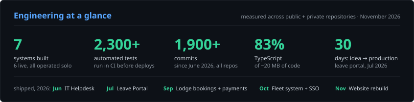
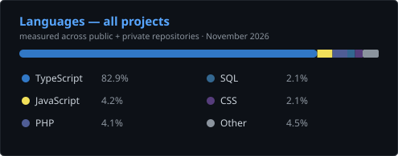

I design, build, and **operate** production systems end to end, from the database
schema to the server they run on.

At [NABOCADO](https://nabocado.org.gh), a development organisation in northern Ghana, I built
and run the organisation's software on my own: a fleet-management system, a single sign-on
service, a leave portal and an IT helpdesk. Through **Athan Digital** I build systems for
clients, including a guest-lodge booking system with mobile-money payments.

🎬 **Start here → [Portfolio](https://github.com/athanasius-ataarem/portfolio)**: screenshots,
narrated demos and engineering notes. 
The production code is in private repositories because it belongs to my employer and my
clients. **I'm happy to walk through it on a call.**

---

## 🏗️ Production systems

| System | What it does | Built with |
| --- | --- | --- |
| **🚐 NABOCADO Transport** [fleet.nabocado.org.gh](https://fleet.nabocado.org.gh) · live since Oct 2026 | Fleet management. Drivers log trips and fuel on their phones **offline** and the app syncs when a signal returns. Odometer-gap and fuel-efficiency checks, vehicle costs split across donor projects by kilometre, verified records made immutable by PostgreSQL triggers, and no location data collected, by design (Data Protection Act, 2012). | TypeScript, Express, Prisma, PostgreSQL, React PWA with an IndexedDB outbox; **1,145 tests**; CI-gated deploys |
| **🔐 NABOCADO ID** | Single sign-on for the organisation's apps: short-lived RS256-signed JWTs checked for audience, replay and state, a staff directory API for apps with service tokens, and two-step sign-in (TOTP). | TypeScript, Express, jose, Argon2, PostgreSQL; **237 tests** |
| **🏨 Restall Guest Lodge** [restallguestlodge.com](https://restallguestlodge.com) · client project, Athan Digital | Booking website, staff app and API. Paystack deposits by **mobile money and card**, with refunds; webhooks verified by HMAC signature and idempotent. SMS through Arkesel and Hubtel and WhatsApp messages through a provider queue that retries. Live updates over WebSockets. | Fastify, Drizzle, PostgreSQL, React PWA, Astro; **Docker** on Hetzner; Cloudflare Pages and R2 |
| **🌿 NABOCADO Leave Portal** [leave.nabocado.org.gh](https://leave.nabocado.org.gh) · live since Jul 2026 | Paper leave forms turned into a digital workflow: routed approvals with digital signatures, an append-only balance ledger enforced by database triggers, an email outbox with retries, and print-perfect A4 PDFs. | Express, Prisma, PostgreSQL, React; **288 tests**; 25 ADRs |
| **🛠️ NABOCADO IT Helpdesk** [helpdesk.nabocado.org.gh](https://helpdesk.nabocado.org.gh) · live since Jun 2026 | Ticketing app staff install on their phones: an office-hours SLA clock, reply by email, an equipment register, push notifications and monthly PDF reports. | Fastify, Drizzle, SQLite, React PWA |
| **🏫 SchoolOS** own product · on staging, ready for its first school | Multi-tenant school management for Ghanaian private schools: report cards, fees, Paystack payments split to each school, and SMS sign-in codes. Works offline on low-end Android phones. | Express, PostgreSQL **row-level security**, React PWA, Docker; Playwright offline end-to-end tests; **711 integration tests** |
| **🌐 nabocado.org.gh** rebuilt Oct–Nov 2026 | The organisation's public website, now under version control with a staging copy, GitHub Actions deploys and Cloudflare in front. | Laravel 13, Filament, MySQL |

## 🔓 Public code

| Repository | |
| --- | --- |
| [**leave-portal-docs-chat**](https://github.com/athanasius-ataarem/leave-portal-docs-chat) | RAG and tool-calling demo: Claude answers questions about the Leave Portal docs and cites what it used, with cost control and abuse resistance built in. |
| [**daybook**](https://github.com/athanasius-ataarem/daybook) | Offline-first daily cashbook for single-shop traders: cash and mobile money in and out, close-of-day reconciliation, and a WhatsApp summary. TypeScript PWA with Prisma and PostgreSQL. |
| [**portfolio**](https://github.com/athanasius-ataarem/portfolio) | Screenshots, narrated demos and engineering notes for the Leave Portal and the Helpdesk. |

## ⚙️ How I work

- **The database enforces the rules.** Append-only ledgers, triggers and constraints, so a bug in the app can't quietly rewrite history.
- **CI gates releases.** Type checks, lint, tests against a real PostgreSQL and a dependency audit run on every push; on the fleet and sign-on systems only a passing commit can be deployed.
- **Built for real networks.** Offline-first apps for Android phones, sync that is safe to repeat, and retries for SMS, email and webhooks.
- **Operated, not just shipped.** Runbooks, nightly off-site backups with restore drills, and monitoring that alerts only when something is wrong.
- **AI-assisted, verified.** I use Claude as a coding agent, approve every change to a live system, and record significant decisions as ADRs.

## 🧰 Tech stack

## 📊 GitHub activity

*Most of my work is in private production repositories, which is what the
contribution graph shows. Code walkthroughs are available on request.*

<picture>
  <source media="(prefers-color-scheme: dark)" srcset="https://raw.githubusercontent.com/athanasius-ataarem/athanasius-ataarem/output/github-snake.svg" />
  
</picture>

## 📫 Get in touch

